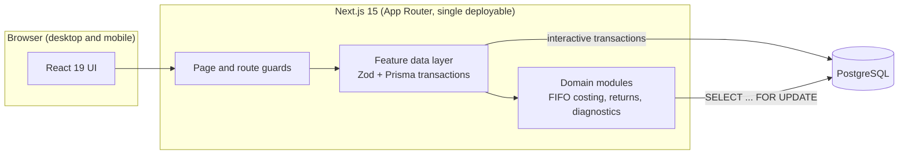
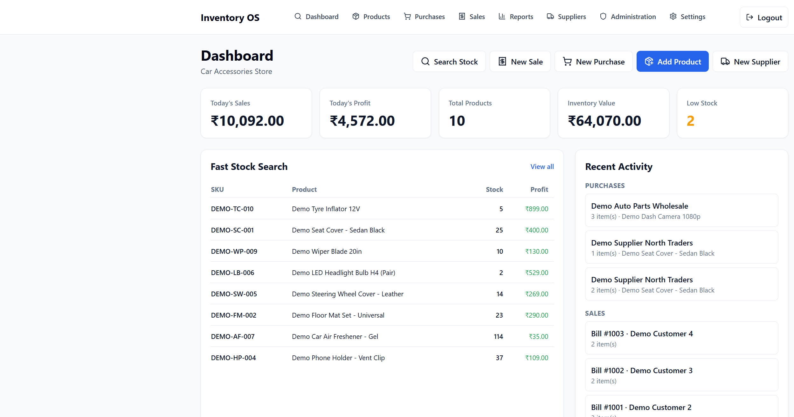
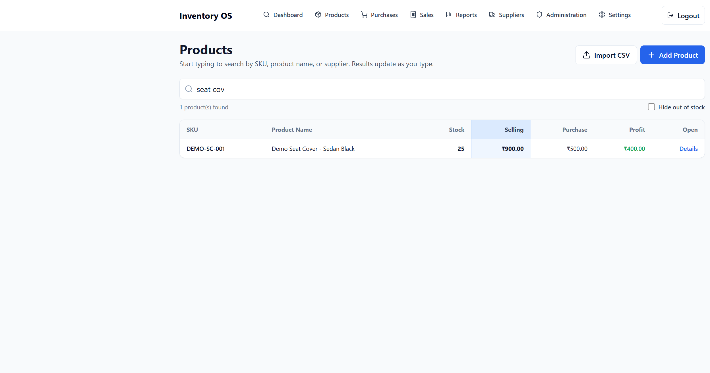
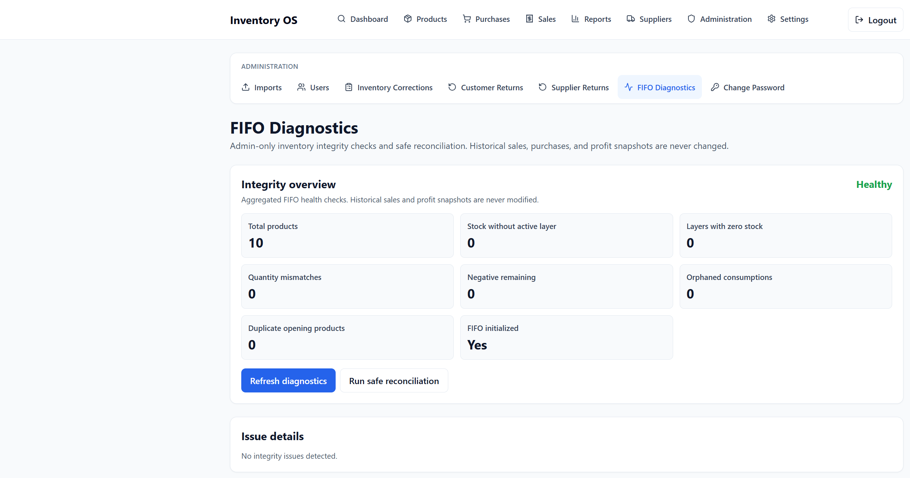
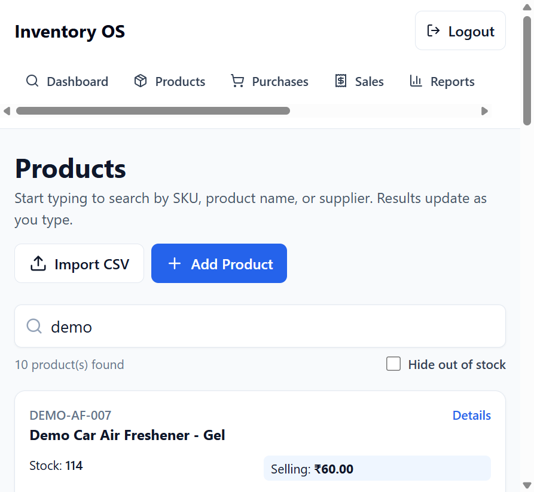

# Inventory & Billing System: Engineering Case Study

A production inventory and billing application I designed, built, migrated and deployed for a small automotive accessories business, replacing a roughly 15-year-old Windows desktop system. This repository is a case study of how it works: **documentation, diagrams, screenshots from a fictional demo environment, and demo data only.** The application source code is in a private repository and is not included here.

> Everything shown was produced from the real application running against a throwaway local database with fictional data. No customer, supplier, pricing or business records appear in this repository.
>
> The system was deliberately built as simple, small-business software. Scope choices such as the absence of an audit trail or a customer database were business decisions, not oversights. See [Design context](docs/design-context.md).

## The four engineering stories

| | What it shows | Read |
|---|---|---|
| **1. Architecture** | One Next.js 15 deployable with a feature data layer, pure domain modules and PostgreSQL transactions; request flow for a sale; auth flow | [Architecture](docs/architecture.md) |
| **2. FIFO costing engine** | Inventory layers, oldest-first allocation, per-line cost snapshots, a traceable consumption ledger, and a safe rollout onto a live business | [Worked example](docs/fifo-costing-worked-example.md) |
| **3. Legacy migration** | SQL Server to PostgreSQL ETL with dry run, pre-flight checks, one verified transaction and idempotent re-runs; about 48,000 sale lines moved with counts and stock totals matching | [Legacy migration](docs/legacy-migration.md) |
| **4. Concurrency** | Row-level locking so simultaneous sales cannot oversell; a reproducible experiment: 6 simultaneous 3-unit sales against 10 units gave 3 accepted, 3 rejected, stock reconciled | [Testing strategy](docs/testing-strategy.md), [script](demo/concurrency-check.ps1) |

## Architecture at a glance



The full set of diagrams is in [`diagrams/`](diagrams/) as Mermaid sources, embedded in the documents.

## My contribution

I was the sole engineer on this project and did all of the work myself, from the first architecture sketch to production. It was built in the Cursor IDE with multiple AI models as tooling, and every design and technology decision was mine.

| | What I did |
|---|---|
| **Designed** | The architecture and data model; the FIFO layer model and its locking strategy; the phased FIFO rollout plan; the role model and session approach; the migration approach and its validation rules. See [Engineering decisions](docs/engineering-decisions.md). |
| **Chose the stack** | Next.js, React, TypeScript, PostgreSQL, Prisma, Zod, Tailwind, Vitest and Docker for the application; Vercel and Supabase for hosting and the database. The reasoning for the main choices is in [Engineering decisions](docs/engineering-decisions.md). |
| **Implemented** | The Next.js application (UI, route handlers, feature data layer); the FIFO engine, returns, purchase-edit rules and diagnostics as pure, tested functions; CSV import and report exports. |
| **Migrated** | Wrote the legacy migration script (ETL) and used it to move about 7,100 products and 48,000 sale lines from the legacy SQL Server database into PostgreSQL, with dry run, pre-flight checks and in-transaction verification. Then moved the database to the hosted PostgreSQL provider and introduced FIFO costing onto the live data with the initialization procedure. |
| **Deployed** | The application on Vercel with the database on Supabase, using the Vercel and Supabase MCP integrations in Cursor; the Docker configuration for self-hosted runs; the deployment runbook that covers the migration rules. |
| **Tested** | 167 unit tests and 3 API smoke tests, typecheck and lint, a from-scratch replay of all 12 migrations, and the concurrency experiment above. See [Testing strategy](docs/testing-strategy.md). |

For this case study I also prepared the documentation, diagrams and fictional demo environment, using Claude Sonnet 5.5 in Cursor.
## Screenshots (fictional demo data)

Dashboard with fast stock search and recent activity:



Product search by SKU or name, normalized so `seat cov` finds `DEMO-SC-001`:



FIFO diagnostics: integrity overview and safe reconciliation (admin only):



Responsive layout used for stock lookup from a phone-sized window:



## What the system does

- Product catalog and fast, phone-friendly stock lookup
- Purchase entry from suppliers, customer billing with discounts and service charges
- Customer returns, supplier returns and stock corrections
- **FIFO inventory costing**, so profit on each bill reflects the cost of the actual units sold
- Role-based access (administrator and read-only staff)
- CSV import and report exports
- Integrity diagnostics for the stock ledger

## Verified numbers

Only numbers I measured or that come from the migration's own verification report:

| Fact | Value |
|---|---|
| Unit tests | 167 passing across 15 files, plus 3 API smoke tests |
| Typecheck and lint | Clean |
| Database migrations | 12, replayed from scratch on an empty database |
| Tables | 15 |
| Legacy data migrated (approximate) | ~7,100 products, ~220 suppliers, ~3,700 purchases, ~6,800 sales bills with ~48,100 lines |
| Migration verification | Row counts, total stock units and bill-number continuity all matched |
| Concurrency experiment | 6 simultaneous 3-unit sales against 10 units: 3 accepted, 3 rejected, stock reconciled |

There is no uptime, performance or user-count claim here because I do not have measurements I would stand behind.

## Tech stack

**Tags:** `TypeScript` `Next.js 15` `React 19` `Tailwind CSS` `PostgreSQL` `Prisma 6` `Zod` `Vitest` `Docker` `Vercel` `Supabase` `SQL Server (legacy source)` `PowerShell` `Mermaid` `Cursor` `MCP (Supabase, Vercel)` `Claude Sonnet 5.5`

| Area | Technologies |
|---|---|
| **Languages** | TypeScript (application, ETL, tests), SQL (PostgreSQL migrations, locking queries; T-SQL on the legacy source side), PowerShell (demo scripts), Markdown and Mermaid (documentation and diagrams) |
| **Frontend** | React 19, Next.js 15 App Router (server components plus client forms), Tailwind CSS 3, React Hook Form, TanStack Table, `lucide-react`, `class-variance-authority`, `tailwind-merge` |
| **Backend** | Next.js route handlers (single deployable, no separate API service), Node.js, Zod for input validation |
| **Data** | PostgreSQL, Prisma 6 (schema, migrations, typed client), raw SQL only for `SELECT ... FOR UPDATE` row locks and a few search and diagnostic queries |
| **Auth and security** | `jose` (HS256 JWT in an `httpOnly` cookie), `bcryptjs` (cost 12), role-based access control with two roles |
| **Legacy migration** | TypeScript ETL run with `tsx`, `mssql` driver and a `sqlcmd` fallback to read SQL Server, idempotent loads into PostgreSQL |
| **Quality** | Vitest (167 unit tests and 3 API smoke tests), TypeScript compiler (`tsc --noEmit`), ESLint with `eslint-config-next` |
| **Containers** | Docker: multi-stage `node:22-alpine` image (Next.js standalone output) and `docker-compose` with `postgres:16-alpine` for local and self-hosted runs |
| **Build and run** | npm, Next.js build, `prisma migrate deploy` on container start |
| **Hosting** | Deployed on [Vercel](https://vercel.com); [Supabase](https://supabase.com) provides the managed PostgreSQL database and its connections |
| **Demo and verification environment** | Windows with PowerShell, Node.js 24, a throwaway local PostgreSQL 17 cluster, Mermaid 11 parser for diagram validation |
| **IDE and AI assistance** | The application was built in the [Cursor](https://cursor.com) IDE using multiple AI models. This case study (analysis, documentation, demo data, screenshots, test and link checks) was prepared in Cursor with **Claude Sonnet 5.5** (Anthropic). |
| **MCP (Model Context Protocol)** | While building the application in Cursor I used the **Supabase MCP** (database and project work, including the database connection) and the **Vercel MCP** (deployment). While preparing this case study, the Cursor browser MCP captured the demo screenshots from the local demo app. |

### Why the versions differ between environments

Three different PostgreSQL and Node setups appear above, on purpose:

- **Docker / self-hosting:** `docker-compose` pins `postgres:16-alpine`, and the application image uses `node:22-alpine`. These are the versions the container setup targets.
- **Production:** the database is managed by Supabase, so its PostgreSQL version is chosen by the provider and is not recorded in this repository.
- **Verification for this case study:** I ran the demo on the PostgreSQL 17 and Node.js 24 that happened to be installed on my Windows machine. I did not rerun the demo and the 12-migration replay on PostgreSQL 16 or Node 22, so compatibility with those versions in this exercise is expected (the migrations are Prisma-managed SQL, a few backfill statements and one raw partial index, with no version-specific features that I am aware of) but not separately verified.

## Scope, trade-offs and limitations

The system is intentionally simple small-business software, and this case study documents its boundaries openly:

- [Design context](docs/design-context.md): why the scope was kept small.
- [Known limitations](docs/known-limitations.md): each item is tagged as a **business decision** or an **engineering gap**, with a suggested fix.
- [Security model](docs/security-model.md): what is implemented, what was deliberately left out, and a prioritized backlog for a different setting.
- [Engineering decisions](docs/engineering-decisions.md): ten decision records with alternatives and consequences.
- [Database design](docs/database-design.md): schema, invariants, migration history and lessons.

A general-purpose inventory and billing product would add many of the omitted features, and anyone adapting this work can add them.

## Repository layout

```text
README.md
docs/           design context, architecture, database design, FIFO worked example, legacy migration,
                security model, engineering decisions, testing strategy, known limitations
diagrams/       Mermaid sources (.mmd)
screenshots/    PNG screenshots from the fictional demo environment
demo/           fictional demo product CSV, concurrency experiment script, demo notes
```
