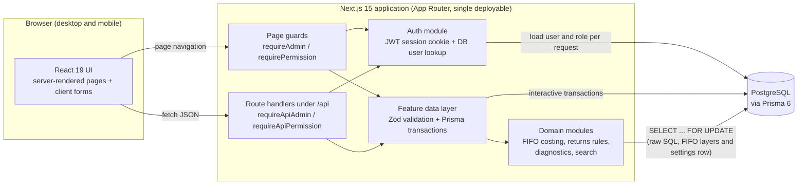
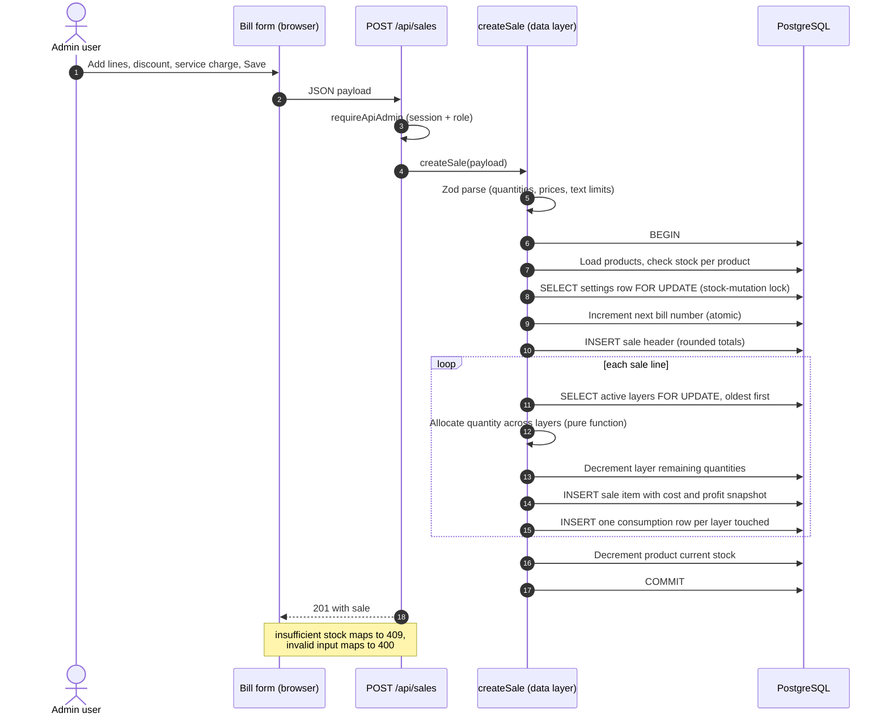

# Architecture

This document describes how the system is put together, how a request flows through it, and why it is shaped that way. Everything here describes the implemented system; planned or aspirational pieces are called out explicitly.

## System at a glance

The application is a **single Next.js 15 deployable** (App Router) with TypeScript throughout. There is no separate backend service: server-rendered pages and JSON route handlers live in the same codebase and talk to **PostgreSQL through Prisma 6**.

Source: [`diagrams/system-architecture.mmd`](../diagrams/system-architecture.mmd)

## Layers and responsibilities

| Layer | Responsibility | Notes |
|---|---|---|
| UI (React 19, Tailwind) | Forms for bills, purchases, returns, adjustments, imports; product search; admin screens | Client forms use React Hook Form with Zod resolvers and call the JSON API with `fetch`. Pages are server components. |
| Page and route guards | Authentication and role checks | Every page and every API route calls a guard explicitly. There is no global middleware. |
| Feature data layer | One module per business area (sales, purchases, returns, adjustments, imports, products, suppliers, users, reports) | Parses input with Zod, opens a Prisma interactive transaction for every stock-changing operation, and throws typed error codes that route handlers map to HTTP statuses. |
| Domain modules | Pure business logic that is easy to unit test | FIFO allocation and weighted-average cost, return-quantity rules, purchase-edit rules, FIFO initialization checks, diagnostics classification, product search normalization. |
| Data access | Prisma Client; raw SQL only where row-level locks are required | `SELECT ... FOR UPDATE` on FIFO layers and on the singleton settings row. Everything else is Prisma query API (parameterized). |
| Database | PostgreSQL | 12 Prisma migrations, one partial index added in raw SQL. See [database-design.md](database-design.md). |

## Request flow: creating a sale

A sale is the most interesting write path because it touches the bill number counter, stock, costing, and profit.

Source: [`diagrams/sale-sequence.mmd`](../diagrams/sale-sequence.mmd)

Points worth noting:

- **One transaction, all or nothing.** Bill number allocation, the sale header, every line, every layer decrement, every consumption record, and the stock decrement commit together or not at all.
- **Two lock scopes.** The settings row lock serializes stock-mutating operations against FIFO initialization; the per-product layer lock prevents two concurrent sales from consuming the same units. See [engineering-decisions.md](engineering-decisions.md) for the trade-off.
- **Before FIFO is initialized**, the layer steps are skipped and the cost snapshot comes from the product's current purchase price. This preserved the legacy behavior during rollout.
- **Cost is snapshotted per sale line**, so later purchases or edits never rewrite historical profit.

## Authentication and authorization flow

1. `POST /api/auth/login` validates credentials against a bcrypt hash and issues a signed JWT (HS256, 8 hour expiry) in an `httpOnly`, `SameSite=Lax` cookie (`Secure` in production).
2. On every request, the guard verifies the JWT and then **loads the user and role from the database**. The role is deliberately not trusted from the token, so role changes and user deletion take effect immediately.
3. Two roles exist. `ADMIN` can do everything; `EMPLOYEE` can only use read-only product lookup.
4. A second factor ("system security password") gates sensitive user-management operations through a separate short-lived (15 minute) cookie.

Details and honest gaps are in [security-model.md](security-model.md).

## Deployment shape

- Hosted as a Next.js application with a managed PostgreSQL database (Vercel and Supabase according to the deployment runbook). Connection strings are provided through environment variables; the app uses a pooled connection for runtime and a direct connection for migrations.
- A multi-stage `Dockerfile` and `docker-compose.yml` exist for local and self-hosted runs (Next.js standalone output plus a Postgres 16 container that runs `prisma migrate deploy` on start).
- Schema changes are applied with `prisma migrate deploy` only; `prisma migrate dev` is restricted to local development. See [database-design.md](database-design.md#migration-history-and-discipline).
- Manual `pg_dump` snapshots were taken before major releases (before the FIFO rollout and before the purchase-edit feature).

## What is not in the architecture

Stated explicitly so the diagram is not over-read. Some items are deliberate (the system was built as very simple software for a small business); others are simply not built yet:

- No message queue, cache layer, background workers, or search engine.
- No application-level audit log table and no per-record "created by" user columns on transactional tables, and no customer table. The business did not want an audit trail or customer tracking; see [design-context.md](design-context.md).
- No automated backup or monitoring code in the application; any such protection comes from the hosting platform, not from this codebase.
- No CI pipeline in the repository at the time of writing.

## Frontend notes

- Server components fetch data directly through the feature data layer; interactive screens (bill form, purchase form, imports, diagnostics) are client components that call the JSON API.
- Product search is paginated with infinite scroll, and the search normalizes names and SKUs so that `SC ALTO T2`, `sc-alto-t2`, and `scaltot2` all match.
- Layout is responsive with a mobile navigation strip so that stock lookup works on a phone, which was a primary requirement of the business.
