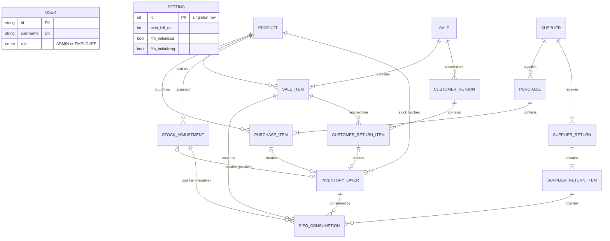

# Database design

PostgreSQL accessed through Prisma 6. The schema has 15 tables and 2 enums, built up over 12 migrations. This document covers the data model, the decisions behind it, and the places where the schema is weaker than I would like.

## Entity overview

Source: [`diagrams/data-model.mmd`](../diagrams/data-model.mmd). The diagram shows relationships and the most important columns only.

### Table groups

| Group | Tables | Purpose |
|---|---|---|
| Catalog | `products`, `suppliers` | What is sold and who it is bought from. `products.current_stock` is a denormalized running total. |
| Purchasing | `purchases`, `purchase_items` | Supplier invoices. Each line creates one inventory layer. |
| Selling | `sales`, `sale_items` | Customer bills. Each line stores a cost and profit snapshot. |
| Costing | `inventory_layers`, `fifo_consumptions` | FIFO batches and the record of which sale line consumed which batch. See [fifo-costing-worked-example.md](fifo-costing-worked-example.md). |
| Corrections | `customer_returns` (+ items), `supplier_returns` (+ items), `stock_adjustments` | Every way stock can legitimately change besides buying and selling. |
| System | `users`, `settings` | Accounts and a singleton configuration row (`id = 1`) that also acts as a lock target. |

## Design decisions

### Denormalized stock plus an auditable layer ledger

`products.current_stock` exists for fast reads (search, dashboard, low-stock). The source of truth for *cost* is the layer ledger. The two are expected to agree: for every product, the sum of `remaining_qty` across its layers equals `current_stock`. The FIFO Diagnostics screen checks exactly that invariant, plus negative remaining quantities, orphaned consumptions, and duplicate opening layers (see [`screenshots/03-fifo-diagnostics.png`](../screenshots/03-fifo-diagnostics.png)).

The cost of denormalizing is that every code path that changes stock must update both. That is why stock-changing operations all go through transactional functions in the feature data layer instead of ad hoc updates, and why direct stock edits are rejected once FIFO is initialized.

### Cost and profit are snapshots on the sale line

`sale_items` stores the weighted-average purchase cost for that line at the moment of sale. Reports read the snapshot. Changing a product's current purchase price, or editing a later purchase, never rewrites historical profit. The `fifo_consumptions` rows keep the exact per-layer trail behind each snapshot.

### Singleton settings row as a serialization point

`settings` always has exactly one row (`id = 1`). It holds the next bill number, the costing method, and the FIFO flags. Stock-changing transactions take `SELECT ... FOR UPDATE` on that row first. This has two effects:

- Bill numbers are allocated atomically.
- A FIFO initialization (which holds the same lock for its whole transaction) cannot interleave with a sale or purchase.

The downside is that all stock-changing writes are serialized through one row. For a single-location shop with a handful of concurrent users this is a deliberate, simple choice; it would not scale to high write concurrency. See [engineering-decisions.md](engineering-decisions.md).

### Traceability links on layers

`inventory_layers` has nullable, unique foreign keys to the thing that created it (`purchase_item_id`, `customer_return_item_id`, `stock_adjustment_id`) and a `source` discriminator (`opening`, `purchase`, `customer_return`, `adjustment`). Unique keys make layer creation idempotent per source row. They also make purchase editing safe: the quantity already consumed from a purchase line's layer is `quantity - remaining_qty`, and an edit that would reduce the line below that number is rejected.

### Idempotent returns

Customer and supplier returns carry a client-generated request id with a unique constraint, so a double-clicked or retried submit does not create a second return (and, for customer returns, a second stock-in layer). Returnable quantity per sale line is computed from prior returns, so partial and repeated returns are supported.

### Money and quantities

Quantities are integers. Money columns are `Decimal(12,2)` in the database. Totals are rounded when a sale or purchase is saved. See [known-limitations.md](known-limitations.md) for where JavaScript floating-point still appears in intermediate calculations.

### Search

Product search normalizes the query, and product names and SKUs, by uppercasing and removing spaces, hyphens, underscores, slashes and periods, so `SC ALTO T2`, `sc-alto-t2` and `scaltot2` match the same product. The normalization of stored values happens at query time with `REGEXP_REPLACE` plus `LIKE`, so no extra column or schema change was needed. With a catalog of a few thousand products this is fast enough in practice, but it is a sequential scan; a trigram index on a stored normalized column is the obvious next step.

## Indexes and constraints

What exists:

- Primary keys and the unique constraints noted above (usernames, SKUs, layer-source links, return request ids, legacy ids used during import).
- A partial index on `inventory_layers` covering only rows with remaining stock, added in raw SQL in a migration. It keeps the hot "find the oldest active layers for this product" lookup small as consumed layers accumulate.

What does not exist, stated plainly (see [design-context.md](design-context.md) for which gaps are deliberate):

- No `CHECK` constraints. Rules such as "quantity is positive" and "remaining quantity is never negative" are enforced in application code and by the diagnostics screen, not by the database.
- No per-record "created by" or "updated by" columns, no audit table, and no separate customer table. These were business decisions: attribution and customer tracking were not requirements for a very small team. Customer details are stored on each sale. Deletes are hard deletes.
- FIFO order is by layer insertion time (`created_at`), not by the business date on the purchase invoice. Back-dating a purchase does not change consumption order.

## Migration history and discipline

| # | Migration | Theme |
|---|---|---|
| 0001 | `init` | Initial products, suppliers, purchases, sales, users |
| 0002 | `remove_product_unit` | Drops an unused product column |
| 0003 | `sale_bills` | Bill numbers (counter on settings, backfilled for existing sales) and customer/vehicle fields on sales |
| 0004 | `billno_string_invoice_required` | Bill numbers become strings; invoice number required |
| 0005 | `legacy_migration_support` | `legacy_*` columns and unique keys for idempotent import |
| 0006 | `supplier_user_schema_cleanup` | Dedicated supplier columns (contact person, tax id, postal code, notes) backfilled from legacy columns that had been overloaded for other purposes; `updated_at` on users |
| 0007 | `user_roles` | `ADMIN` / `EMPLOYEE` role enum |
| 0008 | `system_security_password` | Second-factor hash on settings |
| 0009 | `fifo_inventory_engine` | `inventory_layers`, `fifo_consumptions`, returns tables, snapshots |
| 0010 | `fifo_initializing_lock` | `fifo_initializing` flag for safe initialization |
| 0011 | `returns_idempotency` | Request-id uniqueness on returns |
| 0012 | `adjustment_layer_link` | Link positive adjustments to their layer |

Migrations 0001 to 0008 were written retroactively: the schema was first built iteratively during the legacy migration, and the migration files were authored afterwards to document it. After the database was moved to the hosted provider with `pg_dump` / `pg_restore`, `prisma migrate deploy` was run to establish `_prisma_migrations`.

Two lessons from that history are written into the deployment runbook:

1. **Never run `prisma migrate dev` against a production database.** It detects drift between the history and the live schema and can propose a reset. Local development uses `migrate dev`; production uses only `migrate deploy`, which applies pending migrations and never resets.
2. **Do not edit an applied migration.** Migration 0004 was edited after being applied, so its stored checksum no longer matches the file. The schema is correct and `migrate deploy` still proceeds (it warns), but the safe remedy is to update that single metadata row to the file's current checksum rather than to mark the migration resolved. The cleaner practice, and what I would enforce going forward, is to treat applied migration files as immutable and fix forward with a new migration.

For this portfolio I applied all 12 migrations from scratch to a throwaway local PostgreSQL cluster to confirm the history is replayable end to end.
