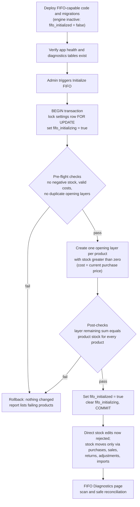

# FIFO costing: a worked example

This is the core business-logic feature of the system, so it gets a concrete walk-through. All numbers below are from the fictional demo dataset (`demo/demo-products.csv` plus a scripted sequence of purchases, a sale and a return run against a local throwaway database). I checked the first sale's result against the running application, and the second calculation against the application's live cost preview.

## Why FIFO

The legacy system recorded one "purchase price" per product and used it to compute profit. That is wrong whenever the same product is bought at different prices: selling a unit that cost 400 as if it cost 500 distorts profit, and the distortion compounds over thousands of bills. For a business with thin margins on many SKUs, profit by bill has to reflect the cost of the units that were actually sold.

FIFO (first in, first out) was chosen because it matches how stock physically moves in this shop and is easy for the business to reason about and verify by hand. The trade-offs against alternatives are in [engineering-decisions.md](engineering-decisions.md).

## The model in one paragraph

Every time stock enters, a **layer** is created: a quantity, a unit cost, a source, and a creation time. Stock leaves by consuming layers **oldest first**. A sale line records a **weighted-average cost snapshot** of exactly the units it consumed, and one **consumption row** per layer it touched. Remaining quantity per layer is the live stock of that batch.

Layer sources:

| Source | Created by | Unit cost |
|---|---|---|
| `opening` | One-time FIFO initialization, from existing stock | Product's current purchase price at initialization time |
| `purchase` | Each purchase line | The purchase line's price |
| `customer_return` | Each customer-return line | The cost snapshot of the original sale line |
| `adjustment` | Each positive inventory correction | Cost entered with the correction |

## Starting state: one product, four layers

Product: `DEMO-SC-001`, "Demo Seat Cover - Sedan Black". The demo history was created in this order:

1. Opening stock of 10 units, initialized at cost 400.
2. Purchase invoice #1: 20 units at 450.
3. Purchase invoice #2: 15 units at 500.
4. Sale (bill 1000): 25 units at a selling price of 800. *(worked below)*
5. Customer return: 5 units from that sale.

### Step 1: the sale of 25 units

Active layers at the time of the sale, oldest first:

| Layer | Source | Remaining | Unit cost |
|---|---|---:|---:|
| L1 | opening | 10 | 400 |
| L2 | purchase #1 | 20 | 450 |
| L3 | purchase #2 | 15 | 500 |

Allocation of 25 units:

| Layer | Consumed | Unit cost | Cost |
|---|---:|---:|---:|
| L1 | 10 (layer emptied) | 400 | 4,000 |
| L2 | 15 (5 left) | 450 | 6,750 |
| **Total** | **25** | | **10,750** |

- Weighted-average cost snapshot: 10,750 / 25 = **430.00** per unit
- Line amount: 25 × 800 = **20,000**
- Profit snapshot: 20,000 − 10,750 = **9,250**

This is what the application showed for bill 1000 (Sales History: "Qty 25, Selling Price ₹800.00, Profit ₹9,250.00"). Two consumption rows were written: 10 against L1 and 15 against L2.

### Step 2: the customer return of 5 units

The returned units re-enter stock as a **new layer at the back of the queue**, costed at the original sale line's snapshot (430), not at the original layer costs. The returned units do not jump ahead of older stock.

| Layer | Source | Original | Remaining | Unit cost |
|---|---|---:|---:|---:|
| L1 | opening | 10 | 0 | 400 |
| L2 | purchase #1 | 20 | 5 | 450 |
| L3 | purchase #2 | 15 | 15 | 500 |
| L4 | customer return | 5 | 5 | 430 |

Product stock is now 5 + 15 + 5 = **25**, which matches the product's stock counter as reported by the application. This is the invariant the diagnostics page checks.

The historical sale's profit is not changed by the return. See [known-limitations.md](known-limitations.md).

### Step 3: the next sale shows FIFO ordering

A new bill for 8 units at a selling price of 900 would consume L2 first, then L3:

| Layer | Consumed | Unit cost | Cost |
|---|---:|---:|---:|
| L2 | 5 (layer emptied) | 450 | 2,250 |
| L3 | 3 (12 left) | 500 | 1,500 |
| **Total** | **8** | | **3,750** |

- Weighted-average cost: 3,750 / 8 = **468.75**
- Line amount: 8 × 900 = 7,200
- Profit: 7,200 − 3,750 = **3,450**

The sales-entry screen's live cost preview showed exactly ₹3,450.00 profit for this bill (I did not save it). Note what FIFO did: the return layer L4 (cost 430, the cheapest) is last in line, so it will not be consumed until L3 is gone.

For contrast, a naive "current purchase price" calculation would give 8 × (900 − 500) = 3,200. The product page's headline "Profit" figure (900 − 500 = ₹400 per unit) is still this simple list-price calculation; it is an indicator, not the sale-time profit.

## Algorithm

Pseudocode for consuming stock for one sale line, as implemented inside one database transaction:

```text
function allocate(productId, quantity):
    layers = SELECT id, remaining_qty, unit_cost
             FROM inventory_layers
             WHERE product_id = :productId AND remaining_qty > 0
             ORDER BY created_at ASC
             FOR UPDATE                      -- block concurrent consumers

    if sum(layers.remaining_qty) < quantity:
        raise insufficient_stock             -- API maps to HTTP 409

    needed = quantity
    allocations = []
    for layer in layers:
        take = min(needed, layer.remaining_qty)
        allocations.append(layer.id, take, layer.unit_cost)
        needed -= take
        if needed == 0: break

    for a in allocations:
        UPDATE inventory_layers SET remaining_qty = remaining_qty - a.take
        INSERT fifo_consumptions (layer, sale_item, a.take, a.unit_cost)

    total_cost = sum(a.take * a.unit_cost)
    return total_cost / quantity             -- stored as the sale line's cost snapshot
```

Properties worth noting:

- The allocation arithmetic is a **pure function** over a list of layers, so it is unit-tested without a database (see [testing-strategy.md](testing-strategy.md)).
- `FOR UPDATE` on the layer rows means two concurrent sales of the same product cannot both read the same remaining quantity. The second transaction waits, then re-evaluates the `remaining_qty > 0` filter against committed data.
- The preview used by the sales form is a **read-only estimate** with no locks; the authoritative cost is only computed at save time inside the transaction.
- Reversal (when a sale line is edited or deleted) reads that line's consumption rows, adds the quantities back to the layers they came from, and deletes the consumption rows. That is why consumption rows are stored per layer rather than only as a total.
- Costing sits behind a `CostingStrategy` interface (allocate, reverse, preview). Only FIFO is implemented; the interface exists so another method such as weighted-average could be added without touching sale and purchase code.

## Rollout: turning FIFO on for an existing business

The business had a catalog of roughly 7,000 products and years of history when FIFO was introduced, so the feature could not simply assume layers existed. See [`diagrams/fifo-rollout.mmd`](../diagrams/fifo-rollout.mmd):



Key points:

- **Before initialization, the new code behaved like the old system.** Sales used the product's current purchase price for the cost snapshot and skipped layers. Deploying the code was therefore separate from changing behavior.
- **Initialization is one transaction** holding the settings-row lock, so no sale or purchase can slip in halfway. If any check fails, everything rolls back and the report lists the offending products.
- **Opening layers use the current purchase price**, which is an approximation: the true historical cost of units already on the shelf is unknown. This is documented as a known limitation, and it only affects the oldest layer of each product.
- **After initialization, direct edits to stock are rejected.** Stock changes only through operations that also maintain layers, which keeps the sum-of-layers invariant true.
- **Diagnostics and a safe reconciliation tool** exist for the case where something still drifts. Reconciliation never alters historical sale or profit snapshots.

## Purchase edits and the consumed-layer rule

A purchase line's layer may already be partly consumed by sales. Editing history must not make past sales impossible, so:

- Quantity cannot be reduced below the quantity already consumed from that line's layer.
- The unit cost cannot be changed once any of the layer has been consumed (it would invalidate recorded profit).
- A consumed line cannot be removed, and a purchase containing consumed layers cannot be deleted.

These rules are small pure functions with their own tests.
