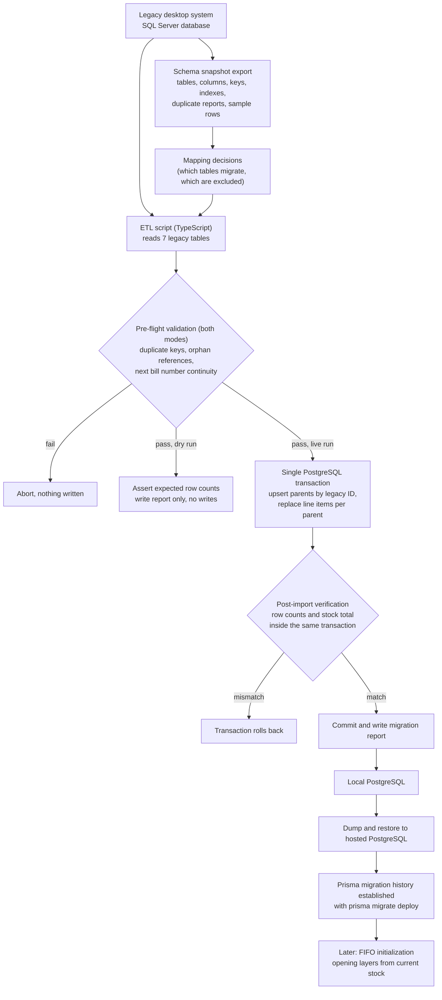

# Legacy migration: Windows desktop system to PostgreSQL

The application replaced a roughly 15-year-old Windows desktop system backed by a **SQL Server** database. The business could not stop trading for the cutover, and the legacy data was its only record of products, supplier purchases and customer bills. This document describes how the data was moved, how correctness was established, and what I would do differently.

## Scale

From the migration script's own verification report (approximate figures; the exact numbers are deliberately not published here):

| Entity | Rows migrated |
|---|---:|
| Suppliers | ~220 |
| Products (with current stock) | ~7,100 |
| Purchase headers / lines | ~3,700 / ~11,900 |
| Sales bills / lines | ~6,800 / ~48,100 |
| Total units in stock | ~20,000 |

The full run took under three minutes against a local PostgreSQL instance.

## Pipeline

Source: [`diagrams/migration-pipeline.mmd`](../diagrams/migration-pipeline.mmd)

## Approach

### 1. Understand before moving

Before writing any import code I exported a schema snapshot of the legacy database: tables, columns, keys, indexes, duplicate-key reports and a small number of sample rows. From that I decided which legacy tables carry business value and which are noise. The ETL reads **seven** tables: suppliers ("dealers"), products, current stock, purchase headers, purchase lines, sales bills and sales lines.

### 2. Target schema built for traceability

Each migrated table has a nullable, **unique `legacy_*` column** holding the source system's primary key (for example the legacy bill-item id on `sale_items`). These columns do three jobs:

- They make re-runs idempotent.
- They let any migrated row be traced back to its source row for dispute resolution.
- They let the post-import checks compare counts per entity.

Products are matched to lines through the legacy part number, and bills to lines through the legacy bill number, with the ETL failing loudly on any line whose parent cannot be found.

### 3. Strict parsing, fail fast

Every field read from a legacy row goes through a typed accessor (`requireString`, `requireInt`, `requireNumber`, `requireDate`) that throws with the table, key and column in the message. There are no silent defaults for required fields. A bad row stops the run with an actionable error instead of producing a plausible-looking wrong database.

### 4. Pre-flight validation

Before any write, in both dry-run and live mode:

- No duplicate keys in the source tables where uniqueness is assumed.
- No orphan references (a line pointing to a missing header or product).
- **Next bill number continuity.** The highest numeric legacy bill number plus one must equal the value the new system will continue from. Bill numbers are visible to customers on paper invoices, so a gap or collision would be noticed immediately.

A `--dry-run` flag runs all reads and checks and writes only a report.

### 5. Single-transaction import

The live run is one PostgreSQL transaction:

- Parent rows (suppliers, products, purchase and sales headers) are **upserted by legacy id**.
- Line items are **replaced per parent** (delete existing lines for the parent, then bulk-insert in batches of 500). The end state is the same however many times it runs.
- Logging reports progress per table.
- Verification queries run **inside the same transaction** before commit. If counts or the total stock quantity do not match the source, the transaction rolls back and the target database is unchanged.
- The transaction timeout was raised deliberately (about an hour) for the live run.

A concrete platform constraint shaped the verification code: PostgreSQL limits bind variables to 32,767 per statement, so counting line items with a large `IN (...)` list of line ids would fail. Counts are instead computed through the parent ids, which are an order of magnitude fewer.

### 6. Preserve legacy numbers; do not "fix" history

Migrated sales lines carry a purchase-price snapshot and a profit value. Where the legacy system stored a zero purchase price on a historical line, the ETL keeps the zero and computes profit from it, exactly as the old system did. Reconstructing a plausible historical cost would have produced numbers that looked better but did not match the paper records the owner already had. Historical reports therefore reconcile with the old system's reports.

### 7. Reading from SQL Server

The ETL can connect using the Node SQL Server driver over TCP. For databases that only accept Windows integrated authentication, a second path (selected by configuration) reads each table through the `sqlcmd` command-line tool as JSON, paged with `OFFSET ... FETCH`, and feeds the same parsing code. Both paths produce the same row objects, so everything after the read is identical.

### 8. Moving to the hosted database

The import ran against a local PostgreSQL instance. The result was moved to the hosted PostgreSQL provider with `pg_dump` / `pg_restore`, and `prisma migrate deploy` was then run to establish migration history. The consequences of authoring the first migrations retroactively are covered in [database-design.md](database-design.md#migration-history-and-discipline).

### 9. Verification that mattered

The verification checks that ran inside the import:

| Check | Meaning |
|---|---|
| Supplier, product, purchase and sales counts | Source rows equal imported rows, per entity |
| Line item counts | Same, for purchase and sales lines |
| Total stock quantity | Sum of legacy stock equals sum of imported stock |
| Next bill number | Continuity with the legacy numbering |

All checks passed in the recorded live run. After cutover, FIFO initialization created opening layers from the migrated stock (see [fifo-costing-worked-example.md](fifo-costing-worked-example.md)).

## What I would do differently

- **Reconcile money, not just counts.** Counts and a stock total catch lost rows, not wrong values. A per-month totals comparison (sales amount and profit) between the legacy reports and the new database would be a stronger acceptance test than counts alone.
- **Write migrations first.** The first eight Prisma migrations were authored after the fact. Writing them as the schema evolved would have avoided the checksum drift described in [database-design.md](database-design.md).
- **Keep the ETL out of the app's `scripts` folder lifecycle.** It is a one-shot tool whose assumptions (for example the hard-coded expected next bill number) were true once. After cutover it should be archived rather than left runnable.
- **Run in parallel before cutover.** A period where staff enter the same bills in both systems and compare would surface edge cases that no import check can.

## What is not covered here

Cutover scheduling, staff training, and the rollback plan lived outside the codebase and are not documented in this repository. Nothing in this repository contains legacy data.
